# TutorLink mobile — flow diagrams

Every block below is a self-contained Mermaid diagram. Copy the code inside any fence into the Mermaid live editor, or leave them here — GitHub, Notion and most Markdown viewers render them as they are.

1. [The whole app at a glance](#1-the-whole-app-at-a-glance)
2. [Getting in](#2-getting-in)
3. [Tutor flow](#3-tutor-flow)
4. [Lecturer flow](#4-lecturer-flow)
5. [Admin — the application queue](#5-admin--the-application-queue)
6. [Admin — tutors, money and messages](#6-admin--tutors-money-and-messages)
7. [A message, end to end](#7-a-message-end-to-end)
8. [What happens to an application](#8-what-happens-to-an-application)
9. [What happens to a session](#9-what-happens-to-a-session)
10. [How navigation actually works](#10-how-navigation-actually-works)

---

## Colour key

The three role colours are the app's own: navy is the tutor, gold is the lecturer, blue is admin — the same three colours the role tags use on every message. A node is coloured by **whose screen or action it is**, so when a tutor diagram turns blue you know the tutor has just handed the job to admin.

Nothing else is allowed to be gold, for the same reason nothing else in the app is: gold has to keep meaning one thing.

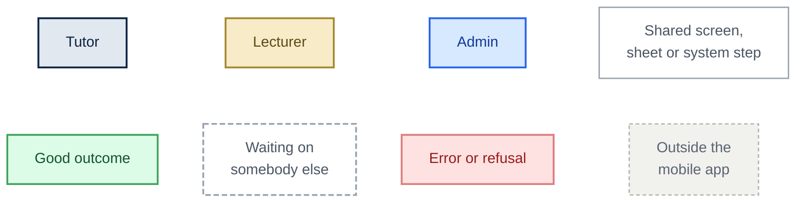

---

## 1. The whole app at a glance

Three roles, three completely different apps, joined underneath by the message threads and by admin approving people into the programme. Signing out of any portal drops you back at the role select.

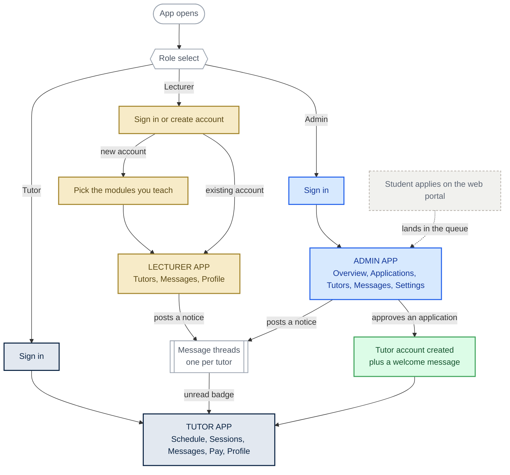

---

## 2. Getting in

The three sign-in routes are deliberately not the same, because the three accounts come into existence in different ways.

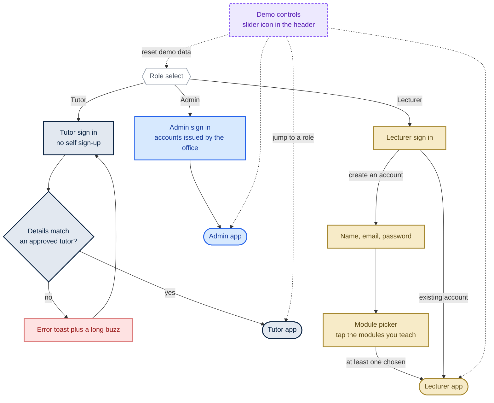

---

## 3. Tutor flow

Two questions, really: where am I meant to be, and have I been paid. The five tabs are peers — switching between them swaps the screen body, it does not go deeper. Watch where the flow turns blue: that is the tutor waiting on admin.

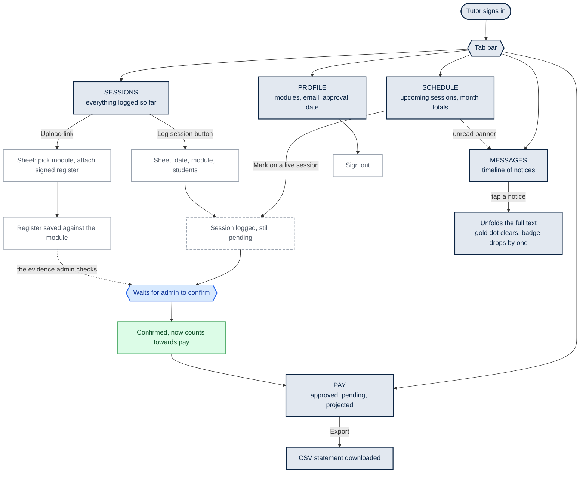

---

## 4. Lecturer flow

The modules chosen at registration decide everything this person can see and everyone they can reach. The one navy node is the hand-off: once it is sent, it belongs to the tutor.

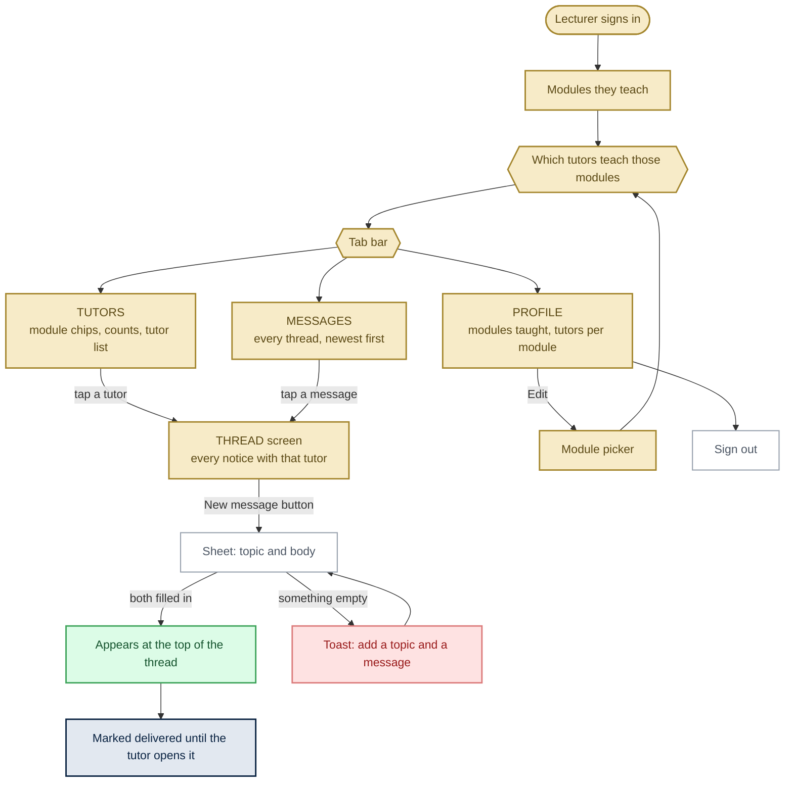

---

## 5. Admin — the application queue

The one decision in the whole system that changes somebody's semester. Approving is green because it ends with a new tutor account and a message already sitting in their inbox.

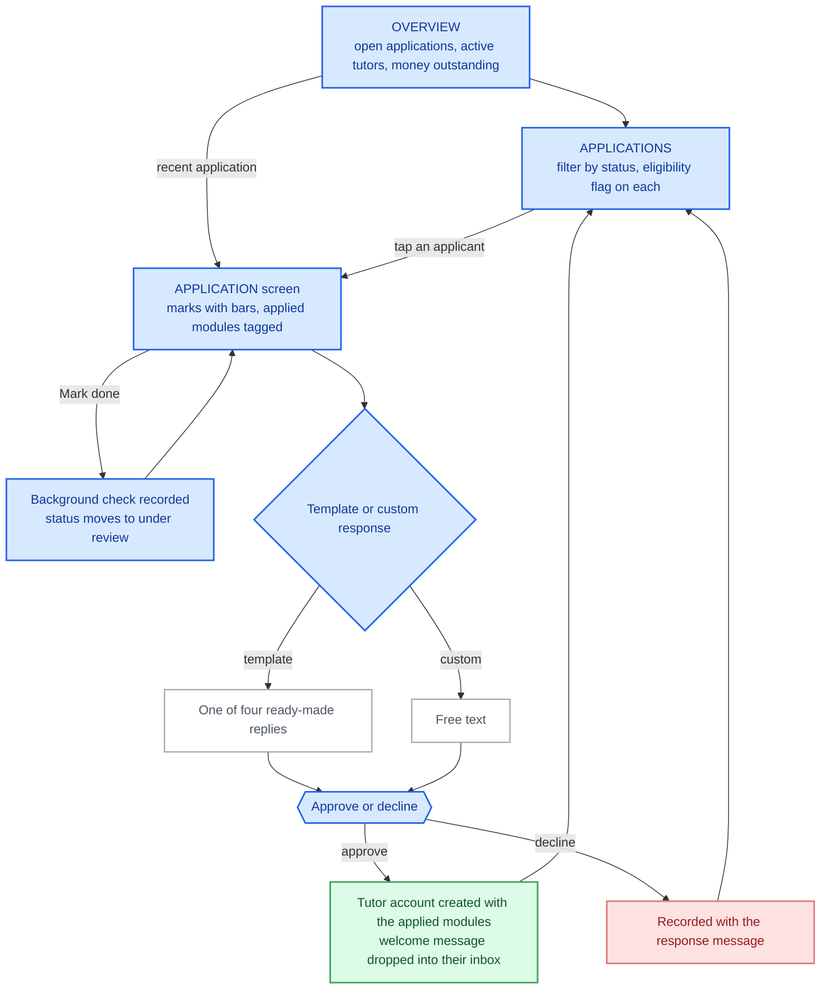

---

## 6. 

The recurring work: confirm sessions, release money, chase people. The navy node at the end is the only part admin does not control — whether the tutor actually reads it.

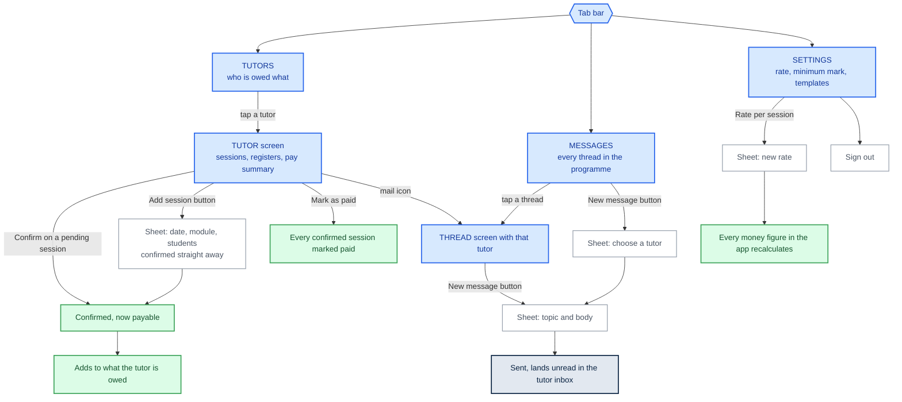

---

## 7. A message, end to end

This is the feature the whole mobile app was built around. The two tinted columns are the two people — gold for the lecturer, navy for the tutor — with TutorLink between them.

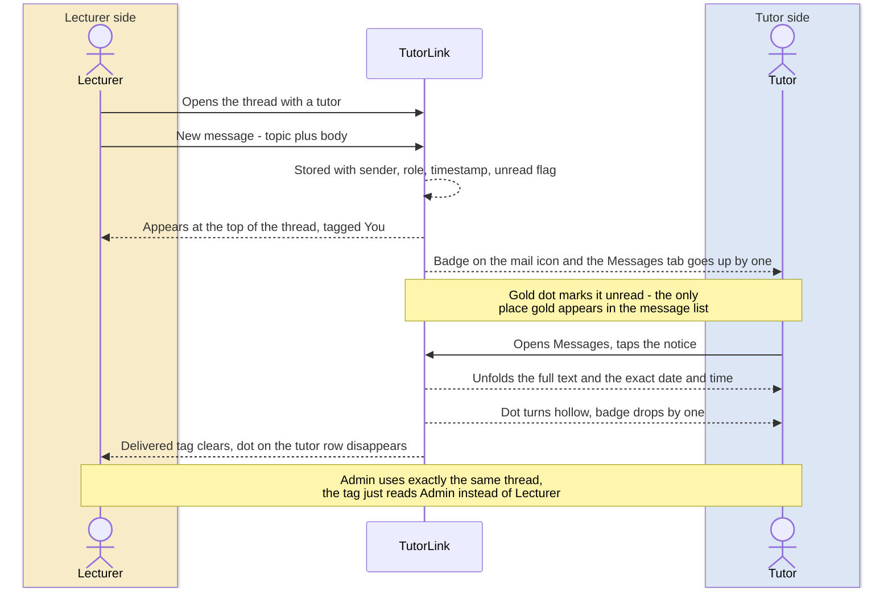

---

## 8. What happens to an application

Starts on the web, finishes on a phone. Every transition here is an admin action, so everything the admin touches is blue.

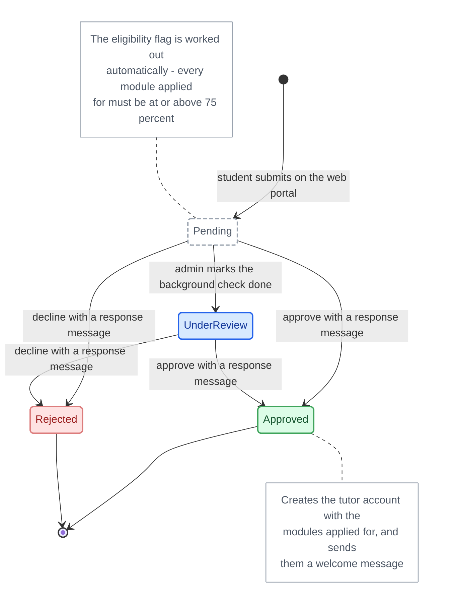

---

## 9. What happens to a session

The reason a tutor cannot pay themselves — the colour changes hands halfway down.

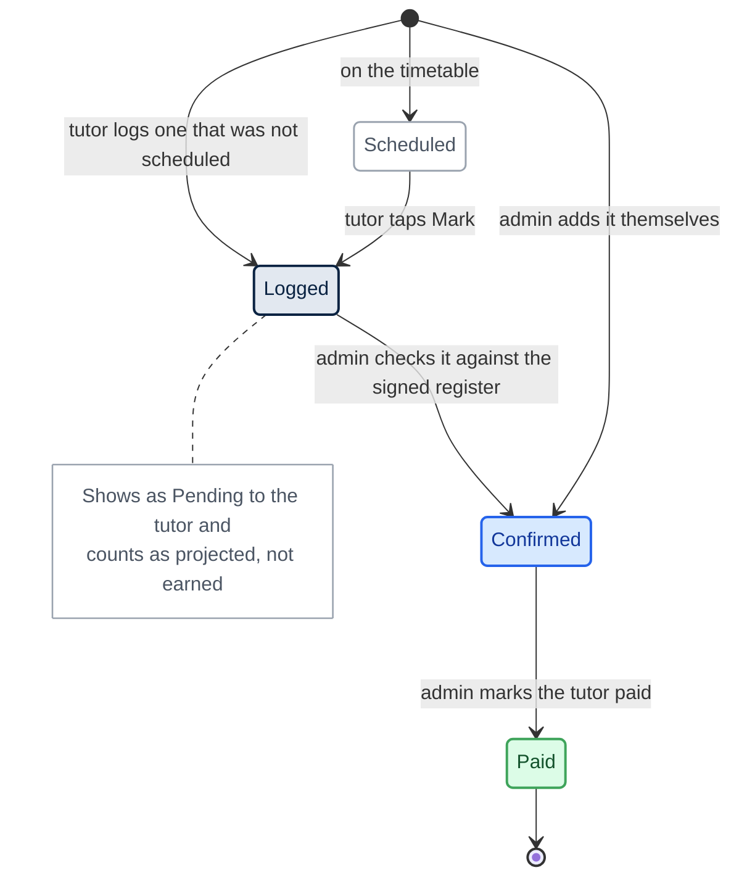

---

## 10. How navigation actually works

Three different movements, so the app knows what to animate. This one is deliberately role-neutral — it works exactly the same way in all three portals.

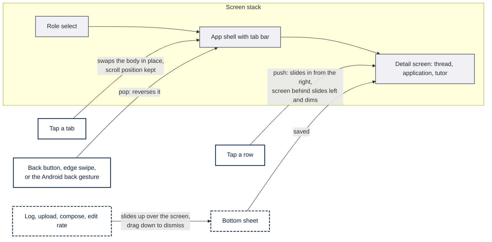
